# swizzin dashboard — Heliedan's edition (unofficial)

> **This branch (`heliedan`) is my personal version of the [Swizzin dashboard](https://github.com/swizzin/swizzin_dashboard), the one that runs on my own server.**
> It is **not official** and not endorsed by the Swizzin team. Feel free to look at it or try it, at your own risk, with no promise of support.
> Like the official project, this edition is under the [GNU GPL v3](LICENSE) (the official project chose it on 2 November 2026, after [#88](https://github.com/swizzin/swizzin_dashboard/issues/88)). It is a modified version: my changes are listed below, and the git history has every one of them with its date.
> The original README follows further down.

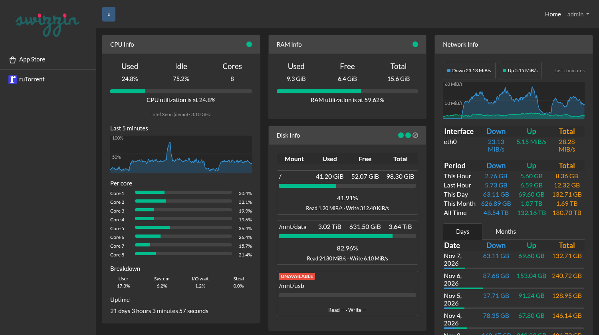


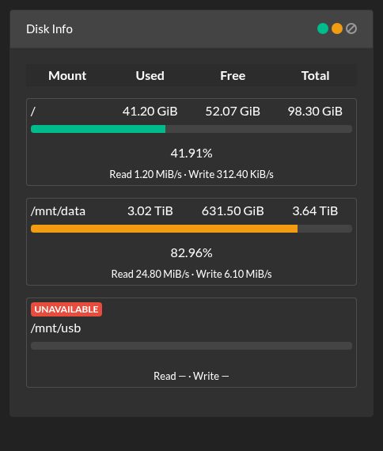

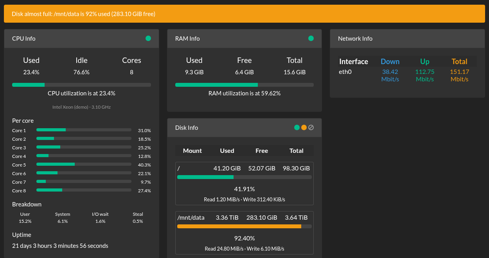 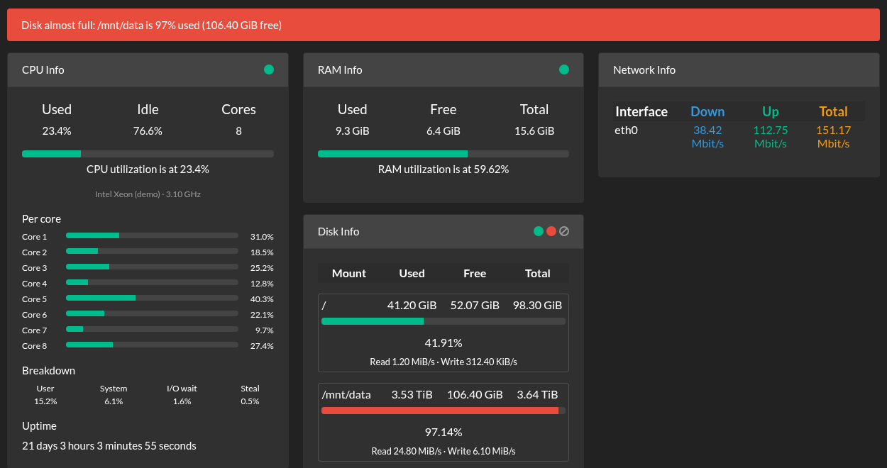

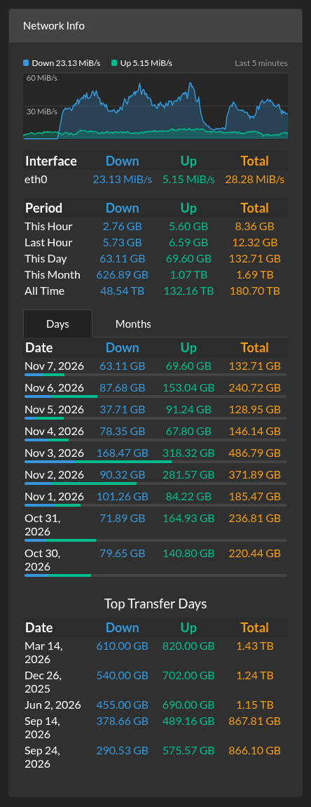 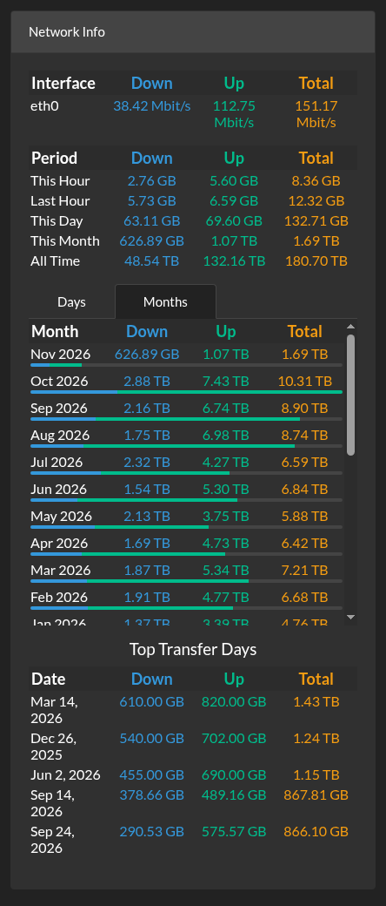

*Screenshots made with demo data: the dashboard with the live cards and their graphs of the last 5 minutes, then the same dashboard in the [Overview layout](#layouts), then the Disk Info card, one box per disk, with a disk that went away shown as UNAVAILABLE, then the disk almost full banner, orange from 90 % and red from 95 %, then the bandwidth history of the Network Info card, by day and by month.*

### What is different from upstream (`master`, b2eca76)

| Change | Proposed upstream |
|---|---|
| **The websocket refuses clients that are not logged in.** The HTTP routes were protected but the websocket handler was not, so anyone able to reach the panel could receive its live broadcasts. | [#83](https://github.com/swizzin/swizzin_dashboard/pull/83) |
| **Errors in custom profiles are logged** instead of silently making every custom tile disappear. | [#86](https://github.com/swizzin/swizzin_dashboard/pull/86) |
| **Service Info keeps refreshing** after a failed poll (it used to freeze until the page was reloaded). | [#87](https://github.com/swizzin/swizzin_dashboard/pull/87) |
| **Disk statistics survive a bad mount:** a path containing a space (written `\040` by Linux) is decoded, and one unreadable mount no longer makes `/stats/disk` fail with HTTP 500. | not proposed yet |
| **Login protection:** after 5 *different* wrong passwords within 10 minutes, an address is refused for 15 minutes (HTTP 429, and the login page says how long to wait), even with the right password. The same wrong password sent again, by a forgotten tab for example, counts only once, and a successful login does not reset the count. The address is the one the local nginx passes on: when the panel is reached directly, the forwarded header is not trusted. Settings in `swizzin.cfg`: `LOGIN_MAX_FAILURES` (number of passwords), `LOGIN_FAILURE_WINDOW` and `LOGIN_BLOCK_TIME` (seconds); `LOGIN_MAX_FAILURES = 0` turns it off. Restarting the panel lifts every block. | not proposed yet |
| **Token logins removed.** Since 2022 (upstream too), checking a token (`Authorization: token ...` or `?access_token=`) failed with an error, so every token was refused, and nothing in the panel could make one. The code is gone, with the `authlib` dependency and the unused `FLASK_SECRET` setting: only the Basic login remains. Such requests are refused like anonymous ones and no longer count as failed logins. | not proposed yet |
| **Python packages with known security flaws are updated.** `requirements.txt` asks for python-socketio 5.16.2 and python-engineio 4.13.2 or newer, which fix denial of service flaws of the realtime server (`/socket.io`, reachable before logging in), and for PyJWT 2.15.0 or newer on Python 3.9 and later (flask-htpasswd pulls it in; the panel never imports it). `heliedan.sh install` now updates the panel's packages when `requirements.txt` asks for newer ones, as `box upgrade panel` does for the official panel. | not proposed yet |
| **Flask 3 and Werkzeug 3.** Upstream keeps Flask and Werkzeug below 3 and dnspython below 2.3, which leaves known flaws in Werkzeug (its debugger, multipart forms, `safe_join` on Windows) and in dnspython. Both limits were workarounds for bugs fixed since: eventlet 0.33.2 and older fail to import with dnspython 2.3 or newer (fixed in eventlet 0.33.3, January 2023), and Flask 3.1.3 broke every websocket connection of Flask-SocketIO 5.6.0 and older (fixed in Flask-SocketIO 5.6.1, February 2026). `requirements.txt` now asks for Flask 3.1.3, Werkzeug 3.1.9, Flask-SocketIO 5.6.1, eventlet 0.40.3 and dnspython 2.9.0 or newer. On older systems, each gets the newest release its Python allows: Flask 3.0.3, Werkzeug 3.0.6 and eventlet 0.35.2 or newer on Python 3.8 (Ubuntu 20.04), and dnspython 2.6.1 or newer before Python 3.11. | not proposed yet |
| **App Store** (admin only, an entry in the sidebar), **optional and off by default**, since it needs a service that runs as root: `sudo bash heliedan.sh enable-store` turns it on. The applications Swizzin can install (system components aside), with their description, installed or not, a search box and filters. **Install** runs `box install <app>` on the server in a live terminal in the page, as over SSH, whiptail menus and questions included. **Uninstall** removes the 24 apps it knows how to remove safely, after saving their settings. See [App Store](#app-store) below. | not proposed yet |
| <a id="live-cards"></a>**Live cards:** CPU Info (replacing System Info), RAM Info and Disk Info are grouped on the left and updated every second over the existing websocket; At a Glance is removed (its badges sit in each card header). Files: `core/custom/live_stats.py`, `templates/cpuinfo.html`, `templates/raminfo_live.html`, `templates/diskinfo_live.html`, `static/js/live_stats.js`, `static/css/live_stats.css`. Code comments in this part are in French. | idea: [#85](https://github.com/swizzin/swizzin_dashboard/issues/85) |
| <a id="live-graphs"></a>**Live graphs of the last 5 minutes:** the Network Info card starts with a graph of the download and upload speed of the default interface, with a legend, the current values and a scale that follows the highest reading of the window, in the units of the speed table (KiB/s, MiB/s...). In the legend, **Down** and **Up** are buttons: a tap or a click hides that series (its label is struck through and greyed, its current value stays) and the scale follows the series still shown, at once; another tap shows it again. One series always stays shown: its button then has no outline and does nothing. The choice is remembered by the browser, in its storage (`localStorage`, key `live-graphs.net-graph.hidden`), unlike the rest of the panel: without storage (private browsing, blocked), both series are shown when the page loads. The CPU Info card gets a graph of the CPU used, from 0 to 100 %. They are drawn from the websocket events the page already receives every second (`speed` and `live`): no new request or event, and no reading stored on the server or in the browser, so they start empty when the page loads. Inline SVG, no library: each reading only moves the existing lines. Each reading is placed at the time it arrived: when no reading comes for more than 2.5 seconds, or the connection is lost, the line is cut, and the gap shows for as long as it lasted. A hidden tab draws nothing and catches up when it is shown again. The bandwidth graph is for the admin only, like the speed table. Files: `static/js/live_graphs.js`, `templates/live_graph.html`, and a few lines in `templates/cpuinfo.html`, `templates/netinfo.html`, `static/js/live_stats.js` and `static/css/live_stats.css`. | not proposed yet |
| **Disk almost full alert:** when a disk shown in the live Disk Info card is 90 % used or more, a banner at the top of the dashboard says so: "Disk almost full: / is 92% used (11.20 GiB free)". It is orange from 90 %, red from 95 %. The disk's bar and badge use the same thresholds and colours: green below the orange threshold, then orange, then red (they used 75 % and 90 %, which CPU and RAM keep). It appears and disappears live, from the numbers the live cards already receive: no new request. The percentage, in the card too, is now computed like `df`: used / (used + available), and "free" is what a normal user can still write (`df`'s Avail column). The blocks ext4 reserves for root (5 %) no longer count as free, so a disk full for your apps shows 100 %, not about 95 %. Users who do not see the Disk Info card do not see it either. ZFS datasets and network mounts (NFS...) raise it too: see [below](#disks-without-a-dev-device). Settings in `swizzin.cfg`, read when the panel starts: `DISK_WARN_PERCENT` (orange, default 90) and `DISK_CRIT_PERCENT` (red, default 95), in percent of the disk used. 0 turns that level off, in the banner and on the bars: both at 0 turn the alert off and leave the disk bars green. An invalid value (text, below 0, above 100) falls back to its default, with a warning in the panel's log. If `DISK_WARN_PERCENT` is not below `DISK_CRIT_PERCENT` (both above 0), orange could never show: it is turned off, red starts at `DISK_CRIT_PERCENT`, and the log says so. | not proposed yet |
| **Bandwidth history** in the Network Info card (admin only): two tabs, **Days** (the last 62) and **Months** (the last 25, both vnstat's default), each line with received, sent and total, and a bar as long as its total compared with the largest of the list (received then sent, in the colours of Down and Up). It replaces the table of the last 10 days: the list scrolls, so the card stays about as tall as before. The refresh every 10 minutes keeps the open tab and how far it was scrolled, and a failed refresh no longer stops the next ones. `/stats/vnstat` now runs `vnstat --json` once instead of ten times, and only for the admin: another user gets HTTP 403, and their dashboard no longer asks. When vnstat is not installed, has no data for the interface yet, gives an answer that cannot be read, or does not answer within 10 seconds, the card says so in a sentence: the page used to fail with HTTP 500, and the card stayed empty until the page was reloaded. The totals and the top days show the same values as before for the same data, checked with the real vnstat of each system Swizzin supports (2.6 to 2.12); vnstat 1, which none of them ships, is no longer read. With `NETWORK_INFO_CUTOFF` in `swizzin.cfg`, the top days are ranked from the days since that date, as `vnstat --begin` did; a value that is not a date written `YYYY-MM-DD` is ignored, with a warning in the panel's log. | not proposed yet |
| <a id="layouts"></a>**Layouts: Classic or Overview.** At the end of the account menu, **Layout** lists the layouts of the dashboard, the one shown ticked: Classic (the cards, as before) and Overview. A click saves the choice for the account, on the server, so that every browser and device shows the same; the page then loads again with it. **Overview** starts with four tiles, CPU, Memory, Disk / and Network, each with its value, a line of detail, its level in words (OK, Watch or Critical; Live for the network) and a small graph of the last 5 minutes. The graphs of CPU and Memory zoom on the readings of the window, so that a change of a few points shows: their scale goes from a multiple of 5 % at or below the lowest reading to one at or above the highest, 10 points high at least (15 to 25 % for a memory steady at 19.2 %) and within 0 to 100 %, and its top and its bottom are written on the left of the graph. The Disk / graph keeps 0 to 100 %, and the Network one the scale of the bandwidth graph. CPU and memory use the thresholds of their cards (Watch above 75 %, Critical above 90 %), the disk those of the disk almost full alert. Then the bandwidth graph with its Down and Up buttons, and the totals of vnstat for this hour, today, this month and all time, next to Service Info (the same buttons). Then **Details**, more about the server: the cards of Classic and a few more, each in a section. By default, Network Info then Top processes are open, each across the whole width of Details; when Details is wide enough, their content is laid out across it rather than down: the tables of Network Info in two columns (from 860 px: the speed, the periods and the top days, next to the Days and Months tabs) or three (from 1200 px: the speed and the periods, the tabs, the top days), and the two lists of Top processes side by side (from 1100 px). CPU Info and RAM Info, which mostly repeat the CPU and Memory tiles, Disk Info and Panel sign-ins are hidden by default: Customize shows them again, as closed sections above those, in two columns on a wide screen (CPU Info and RAM Info on the left, Disk Info and Panel sign-ins on the right, each column stacking on its own; a column with nothing to show gives its width to the other). Disk Quota Info, when the quota is installed, is shown by default: a closed section, across the width of Details above Network Info. Those widths are the width of Details, sidebar shown or not (CSS container queries); narrower, as on an iPad held upright or a phone, or in a browser without container queries (Safari before 16), everything stacks as in Classic, and the Network Info card of Classic keeps its look. The browser remembers what differs from the default: the sections opened (`localStorage`, key `overview.open`) and those closed among the ones open by default (key `overview.closed`). Same data and same rights as Classic: the tiles come from the websocket events the page already receives, the totals from the bandwidth card's own refresh, and no new request is made. The bandwidth tile, graph and totals are for the admin only, like the speed table; the Disk tile, like the Disk Info card, for everyone without a disk quota, and the admin. The choices are kept by the panel in `layouts.json`, next to `swizzin.cfg` (readable by the panel's account only; updates leave it alone). `DASHBOARD_LAYOUT` in `swizzin.cfg` (`"classic"` or `"overview"`) is the layout of the accounts that chose none: Classic unless it says otherwise. A missing or broken file, or a name this version does not know, gives that default: the dashboard always shows. The Classic page is unchanged, the menu aside. Files: `core/layouts.py`, which keeps its file through `core/statefile.py` (the small JSON files of the panel next to `swizzin.cfg`), `core/overview_blocks.py` (the list of the blocks of Overview, each with its zone, its template and its script if any: `templates/index.html` loads the scripts from it), `templates/overview.html` and the templates of its blocks in `templates/overview/`, `static/js/overview.js`, `static/css/overview.css`, `static/css/network.css` (Network Info across the width of Details), and a few lines in `swizzin.py`, `core/config.py`, `templates/index.html`, `templates/macros.html`, `templates/live_graph.html`, `templates/netinfo.html`, `templates/top.html`, `static/js/live_stats.js`, `static/js/live_graphs.js` and `static/js/swizzin.js`. | not proposed yet |
| <a id="home-screen-icon"></a>**Home screen icon.** The panel can be added to the home screen of an iPad or a phone (*Add to Home Screen*, in Safari's share menu) with the Swizzin logo as its icon and "swizzin" as its name, and asks to open full screen, without the browser's bars, like an app (`"display": "standalone"`). Every page of the panel (the dashboard in both layouts, Stats, the App Store, the login and logout pages) names in its head a web app manifest (`static/manifest.json`) and an icon for Apple. The icons are opaque: the Swizzin logo in white on its teal (`#0C6665`), 180 × 180 for Apple, 192 × 192 and 512 × 512 for the manifest, and a 512 × 512 one with a wider margin for the round or rounded masks of Android. Like everything in `/static`, they are served without a login, since the phone reads them before logging in; they say nothing about the server. The manifest's addresses are relative to it, so the app opens the root of the panel, at `/` as under `URLBASE`. No service worker and nothing kept offline: the app shows the live panel and asks for the login as the browser does. The login page now lets the browser's password manager fill it in (`autocomplete`) and fits the width of a phone. Files: `static/manifest.json`, `static/img/home/`, `templates/head_icons.html`, and one line in the head of `templates/index.html`, `templates/login.html`, `templates/logout.html`, `templates/stats.html` and `core/custom/store/templates/store/store.html`. | not proposed yet |
| <a id="system-status"></a>**Reboot required and pending updates** (Overview, admin only): after the title of At a glance, **Reboot required** (orange) when the system asks for one, and **12 updates · 3 security** when apt has updates to install (orange when some are security updates, grey otherwise). A tap or a click on one opens its details: the packages that asked for the reboot, the security updates, and the date of the package lists. Nothing shows when there is nothing to say. The count is what `apt-get -s dist-upgrade` would install: a simulation, run by the panel's own account, which needs no root, takes no lock and changes nothing. The panel never runs `apt update` (apt-daily or you keep the lists fresh): when they are 7 days old or more, the pill says so. The simulation takes a few seconds of CPU at the lowest priority, so it never runs during a request: one at a time, in the background, when the admin's Overview asks, and again only after dpkg or apt changed something (installed packages, package lists), at most once a minute; meanwhile the page shows "Checking for updates…". When it fails (apt busy or broken, no answer within 60 seconds), the previous count stays and the panel's log says why; without a count yet, the pill says "Updates unknown". The reboot comes from `/run/reboot-required`, which Ubuntu (update-notifier) and unattended-upgrades write, with the packages that asked; where neither is installed (Debian without unattended-upgrades), a newer kernel installed in `/boot` than the one running says so too, but never in a container or with a kernel the host provides. A system without apt shows neither count nor pill. Other accounts see nothing, and the route `/stats/system-status` answers them HTTP 403; it is never cached. `UPDATES_CHECK = False` in `swizzin.cfg` turns the count off (the reboot pill stays). Files: `core/system_status.py`, `templates/overview/system_status.html`, `static/js/system_status.js`, and a few lines in `swizzin.py`, `core/config.py`, `core/overview_blocks.py`, `templates/overview.html` and `static/css/overview.css`. | not proposed yet |
| <a id="service-logs"></a>**Logs of a service** (Overview, admin only): each line of Service Info gets a **Logs** button. It opens a panel under the row with the last lines of that service's journal (100 by default) and what systemd says of it: running or stopped, since when, and its automatic restarts (`NRestarts`: the restarts systemd made by itself because of `Restart=`, counted since the service was last started by hand or since the boot). **Refresh** reads them again, **Close** hides the panel. The journal is readable by root and the group `systemd-journal` only, so a small **journal reader** of this edition reads it for the panel (`journal-helper/`, Python standard library only), without the App Store: not as root, but as its own system user, `swizzin-journal`, with the group `systemd-journal`. systemd starts it for each read, through a socket that only root and the panel's group can open (`swizzin-journal.socket`, mode 660), and it checks the account of the other end again; its unit gives it no privilege and keeps it in a sandbox: a read-only system, no network (Unix sockets only), its own `/tmp`, no other process in `/proc`, a list of allowed system calls (`systemd-analyze security` rates it 0.4, "SAFE", with systemd 247 or newer; 0.6 on Ubuntu 20.04, whose systemd 245 does not know two of its settings and ignores them). It reads only the services of the panel's profiles, from its own copy of their list (the service of a custom tile is not read), passed as `--unit=<name>` to a fixed `journalctl` command, 200 lines, 256 KiB and 5 seconds at most, one read at a time; terminal escape sequences are removed from the lines and control characters replaced, and each read is noted in its own log (`journalctl -t swizzin-journal`). `heliedan.sh install` sets it up, `revert` removes it. Without it (a panel switched by hand, or by an older `heliedan.sh`), the panel says so (`sudo bash heliedan.sh install` sets it up) and still shows the state. Many apps (Sonarr, Radarr...) write their own log files: their journal then only shows when they start and stop, and errors at start. Nothing is kept, and the answer is never cached. In `swizzin.cfg`, `SERVICE_LOGS = False` removes the buttons, and `SERVICE_LOGS_LINES` sets the number of lines (1 to 200); an invalid value falls back to its default, with a warning in the panel's log. The Classic page is unchanged. Files: `core/service_logs.py`, `static/js/service_logs.js`, `journal-helper/` (the reader, its socket and service units, and its `install.sh`), and a few lines in `swizzin.py`, `core/config.py`, `core/overview_blocks.py`, `templates/macros.html`, `templates/overview/services.html` and `static/css/overview.css`. | not proposed yet |
| <a id="signins"></a>**Panel sign-ins** (Overview, admin only): a section of the Details lists the recent sign-ins to the panel (when, the account, the address) and the failed attempts (when, the name typed when it is an account, the address, how many, and **blocked 15 min** when the login protection then refused the address), the 10 newest of each. The address the page is read from is marked "your address" (other devices behind the same router share it). With the Basic login every request carries the password, so a sign-in is the first request of an account from an address after 30 minutes without one: a page left open counts once. The failed attempts of the same name from the same address less than 10 minutes apart make one line with their count, so that a forgotten tab sending an old password does not fill the list. Only the time, the account, the address and the result are kept, never a password: a name that is not an account of the panel is never kept either (it may be a password typed in the wrong box), and its line says "unknown account". The address is the one the login protection uses, IPv4 or IPv6: the one the local nginx passes on (behind another proxy, such as Cloudflare, that proxy's). The panel keeps them in `signins.json`, next to `swizzin.cfg` (readable by the panel's account only; updates leave it alone), so that they survive a restart of the panel: 30 days after their last request, and 100 sign-ins and 100 failed attempts at most, so that failures never push the sign-ins out. `SIGNIN_HISTORY_DAYS` in `swizzin.cfg` sets the days (up to 365); `0` keeps them in memory only, until the panel restarts, and removes the file; an invalid value falls back to 30, with a warning in the panel's log. A sign-in is written at once, failures at most once a minute, and what only moves a time or a count at most every 10 minutes: an attack does not make the panel write its disk in a loop. The section is hidden by default (Customize shows it). It asks only while it is open and shown, every minute: never while it is hidden, even when the browser remembers it open. Other accounts see nothing, and the route `/signins` answers them HTTP 403; it is never cached. Only the logins to the panel are seen: the other apps behind nginx check the same passwords without it. On a shared server, the admin sees the addresses of the other accounts (nginx's logs have them too). The Classic page is unchanged. Files: `core/signins.py`, `templates/overview/signins.html`, `static/js/signins.js`, and a few lines in `core/htpasswd.py`, `swizzin.py`, `core/config.py`, `core/overview_blocks.py` and `static/css/overview.css`. | not proposed yet |
| <a id="top-processes"></a>**Top processes** (Overview): a section of the Details, open by default across their whole width, with two lists: the 5 programs that used the most CPU in the last seconds, and the 5 that use the most memory, each with its account, its CPU, its memory and its share of the memory, and a small bar. The admin sees every program; any other account, on a shared server or not, the programs of the Linux account of the same name only, and none without one. Only the name of a program shows, the one the kernel keeps (15 characters, as `top` shows it), never its command line nor its environment, which can hold passwords or tokens. CPU is the share of the whole processor, counted as the CPU tile counts it: a program that keeps one core busy out of 8 shows 12.5 %, where `top` would say 100 %. Memory is the resident memory (RSS), which counts what a program shares with others (libraries...). The panel reads `/proc` itself, without root and without running `ps`: `/proc/<pid>/stat` of each process, and `/proc/<pid>/status` for those that seem to run as root, to know the account of the workers of nginx or php-fpm. It reads only while the section is open and the browser tab shows: the page asks every 5 seconds, and nothing at all while the section is closed or hidden with Customize. One reading at a time, shared by every browser and every account and kept 3 seconds; the first one takes two readings 1 second apart. A reading takes a few tens of milliseconds for a few hundred processes, and pauses every 200 processes so that the live cards and the other requests go on meanwhile. When `/proc` is mounted with `hidepid` (or the panel runs with `ProtectProc=`), the panel's account sees its own processes only: the section says so. In a container (LXC...), the processes of the container. The route `/stats/processes` is never cached. `TOP_PROCESSES = False` in `swizzin.cfg` removes the section; any other value than `True` or `False` counts as `True`, with a warning in the panel's log. The Classic page is unchanged. Files: `core/processes.py`, `templates/overview/processes.html`, `static/js/processes.js`, `static/css/processes.css`, and a few lines in `swizzin.py`, `core/config.py` and `core/overview_blocks.py`. | not proposed yet |
| <a id="customize"></a>**Customize Overview**: each account arranges its Overview. **Customize**, at the right end of the heading of At a glance, opens an editor under it: one list per zone of the page (the pills next to At a glance, the tiles, the row under them, each column of Details, and its whole width), each block with **↑** and **↓** to move it within its zone, **Hide** (pressed for a block hidden by default, such as CPU Info: pressing it shows the block), and, for a section of a column of Details, a button that moves it to the other column (the sections across the whole width stay there). They are buttons: a mouse, a finger or the keyboard works, the focus stays on the button pressed, and a screen reader hears where the block went ("CPU: position 2 of 4 in Tiles."). Nothing changes on the page before **Done**, which keeps the arrangement on the server, for the account (every browser and device shows it), and loads the page again in that order; **Cancel** forgets the changes; **Reset to default** puts the default arrangement in the editor, for Done to keep. The panel renders the page in the account's order, so that the keyboard and screen readers follow it too. A hidden block stays in the page, with the `hidden` attribute: the scripts that fill it or read it keep working, and an account gets no more and no less than before. Hiding is not a right: a block of the admin is never rendered for another account, whatever its arrangement says, and the editor lists only the blocks of the page. On a narrow screen, Details is one column, the left one then the right one, then the sections across its width; on a wide one, a column left with nothing to show gives its width to the other. The arrangement is kept in `layouts.json`, with the layout, and says only what the account changed from the default: the blocks it hid among those shown by default (`hidden`), the blocks it shows among those hidden by default (`shown`), the order and the sections in the other column; a block it says nothing of keeps its default, so that an arrangement made before a block was hidden by default gets it hidden like everyone else, and keeps what it hid: an account that never arranged anything keeps its plain name there, so that a file of the previous version only changes for the accounts that arrange, and a change that changes nothing writes nothing; choosing Classic keeps the arrangement for later, and Reset gives the plain name back. What this version cannot read in an arrangement is left out (a block it does not know, such as one a later version adds or one it no longer has, a block given twice, more than 64 per list, a section that now takes the whole width of Details in `other_column`), and `POST /layout/arrange` refuses it (HTTP 400; JSON only, for the account logged in; a block both hidden and shown too). A block added to `core/overview_blocks.py` can be arranged like the others, with nothing more to write; one that an arrangement does not list goes at the end of its zone. An earlier version of this edition shows each account's layout without its arrangement (and forgets it if the account chooses a layout there); the version before the blocks hidden by default leaves out `shown`, and shows every block the arrangement does not hide, CPU Info and RAM Info included, as it did; the version before Disk Info and Panel sign-ins were hidden by default shows them, as it did, and puts Network Info and Top processes in the order the arrangement says, Top processes first without one. Without an arrangement, the page is the same as before but for the Customize button and its script. Files: `static/js/arrange.js`, `core/layouts.py` (the arrangement, read, checked and kept), and a few lines in `swizzin.py` (the route), `core/overview_blocks.py`, `templates/overview.html` and `static/css/overview.css`. | not proposed yet |

In the live Disk Info card, **each disk has its own light box** with its read/write speeds, and a disk that becomes unreadable or is unmounted while the page is open is shown as **UNAVAILABLE** (crossed circle ⊘ in the header, since the coloured badges stand for how full a disk is) instead of freezing the CPU and RAM cards or showing stale numbers. Disks plugged in or removed are picked up within 30 seconds; hovering a badge shows its percentage.

<a id="disks-without-a-dev-device"></a>**Disks without a `/dev/` device** (ZFS datasets, network shares such as NFS) are followed live like the others, and raise the disk almost full alert, but without read and write speeds (shown as —: Linux counts none for them). The live card used to leave them out: `/stats/disk` filled them when the page loaded, then the first live reading marked them UNAVAILABLE. Following them live was the coherent way out; dropping them would have hidden a full ZFS pool or NAS. The catch: on a network share that stopped answering, asking for the free space can wait forever, and the panel runs everything in one thread (eventlet), so that wait would freeze the whole panel, live cards included. So these mounts are read apart, each in its own system thread, one reading at a time per mount:

- the live cards never wait: they show the mount's last answer, and after 5 seconds without one, UNAVAILABLE;
- `/stats/disk` waits 5 seconds at most, then leaves the mount out (and logs it), as it does for any unreadable mount;
- nothing can interrupt a thread stuck on a dead share: it stays until the share answers, but no other reading of that mount is started meanwhile, so threads do not pile up. When the share answers again, the mount comes back by itself.

Disks with a `/dev/` device are read directly, as before: a local disk normally answers at once. A disk mounted inside a mount without a `/dev/` device (a USB disk at `/mnt/nas/usb` in an NFS share at `/mnt/nas`, for example) is the exception: reaching it goes through the share, so it is read apart too, with the same limits, and keeps its read and write speeds.

<a id="stats-disk"></a>**For scripts that call `/stats/disk`** (with the panel login): it answers one entry per mount of the Disk Info card, with `disktotal`, `diskused`, `diskfree` (text such as `"11.20 GiB"`, or `"12.03 GB"` with `DISK_UNITS = "si"`), `perutil` (the percentage used, computed like `df`, as text with two decimals such as `"92.34"`) and, new in this edition, **`alert`**: the level of the disk almost full alert, with the thresholds of `swizzin.cfg`.

- `"critical"`: `perutil` is at or above `DISK_CRIT_PERCENT` (red, default 95);
- `"warning"`: `perutil` is at or above `DISK_WARN_PERCENT` (orange, default 90), but not critical;
- `null`: neither: below the thresholds, or the level it reached is turned off (0).

```json
{"/": {"disktotal": "100.00 GiB", "diskused": "50.00 GiB", "diskfree": "50.00 GiB", "perutil": "50.00", "alert": null},
 "/mnt/data": {"disktotal": "100.00 GiB", "diskused": "92.34 GiB", "diskfree": "7.66 GiB", "perutil": "92.34", "alert": "warning"}}
```

A mount that cannot be read, or that has not answered within 5 seconds, is left out.

### App Store

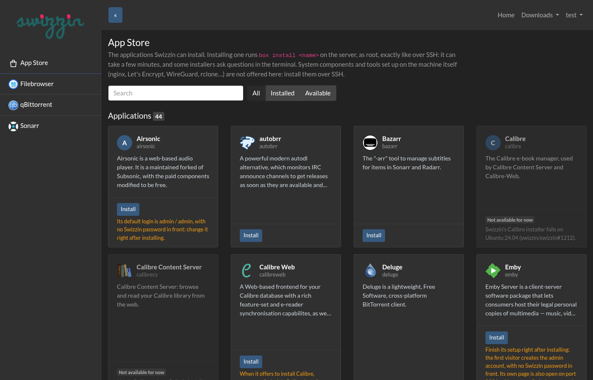

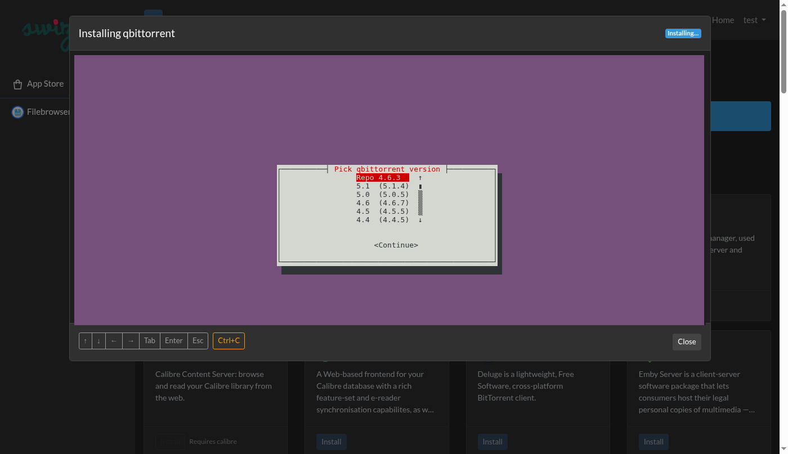 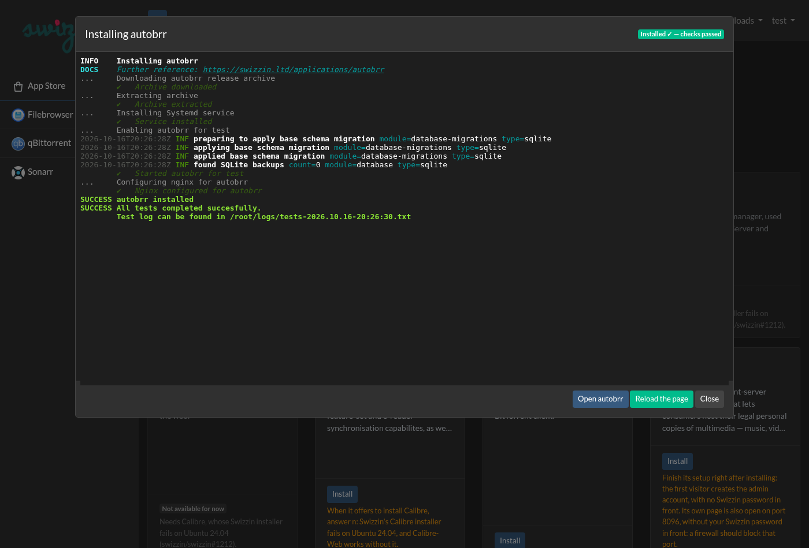

*Screenshots from a throwaway test server: the App Store page, the qBittorrent installer's version menu in the page's terminal, and the end of an installation (autobrr).*

The panel runs as the `swizzin` user, which cannot even read the list of Swizzin applications (`/etc/swizzin` belongs to root). A small root service, **swizzin-store** (`store-helper/`, Python standard library only), lists the applications and runs the installations and uninstallations; the panel relays them to the page.

**The App Store is optional, and off by default:** a service that runs as root is the most sensitive part of this edition, so it is there only if you ask for it. Off, the panel has no App Store page, sidebar entry or route (`/apps` answers 404, as on the official panel), and no root service runs; the rest of the edition, the Logs buttons included, works without it. To turn it on, and off again:

```bash
sudo bash heliedan.sh enable-store    # installs the swizzin-store service, writes APP_STORE = True in swizzin.cfg, restarts the panel
sudo bash heliedan.sh remove-store    # removes the service, writes APP_STORE = False, restarts the panel
```

The panel reads `APP_STORE` in `swizzin.cfg` when it starts: `False` (the default, when the line is missing) or `True`; another value counts as `False`, with a warning in its log. `True` without the service shows the page with a message that says how to install it. An update of the edition keeps the App Store as it was: `heliedan.sh install` updates the service where it is installed and installs it nowhere else. A server where an older version (3.0 or before, when it was always on) installed it keeps it: the update writes `APP_STORE = True` in `swizzin.cfg` (once, when the line is missing), so that nothing changes for you. By hand, without `heliedan.sh`: `store-helper/install.sh` (as root, from a copy of this branch that the panel user cannot write; `--uninstall` removes it), then `APP_STORE = True` in `swizzin.cfg` and a restart of the panel.

- **One installation at a time:** `box install <app>`, then a check once the app's lock file is there (Swizzin's `box test`, or the App Store's own check for [16 apps](#compatibility)), and the page shows the result. It keeps going if the tab is closed or the panel restarts (some installers restart nginx or the panel): the page reconnects and replays the output.
- **Whoever started it types in the terminal;** other tabs watch until they take control. A row of keys (arrows, Tab, Enter, Esc, Ctrl+C) helps on a tablet.
- **Not offered:** system components and tools set up on the machine itself (nginx, Let's Encrypt, WireGuard, quota, rclone, ffmpeg, vsftpd, DuckDNS, Webmin, Shellinabox, X2Go, the panel itself), and xmrig. Install those over SSH.
- **Security:** the page and its websocket are for the admin only, logged in with the panel password; the websocket also wants a token that only the panel's own pages can read, and refuses other sites. Before installing or taking control, the admin password is asked again (wrong ones count as failed logins). `STORE_ASK_PASSWORD = False` in `swizzin.cfg` turns that off: keep it on if your panel is reachable from the Internet or used from shared computers, since a panel login never expires by itself. The service accepts only root and the panel user, runs nothing but `box install`, `box test`, its own check and the checked remove scripts of [24 apps](#the-apps-it-uninstalls), with a name from Swizzin's own list, and gives them a clean environment. Each installation and uninstallation is logged in `/var/log/swizzin-store` (root only); what is typed is not logged, only how much.
- **New web addresses:** an installation usually adds an nginx location for the new app. If you restrict access to your server (allowed addresses, VPN), check it.
- **Not there yet:** updating an app from the page (`box upgrade` over SSH).

#### Uninstalling

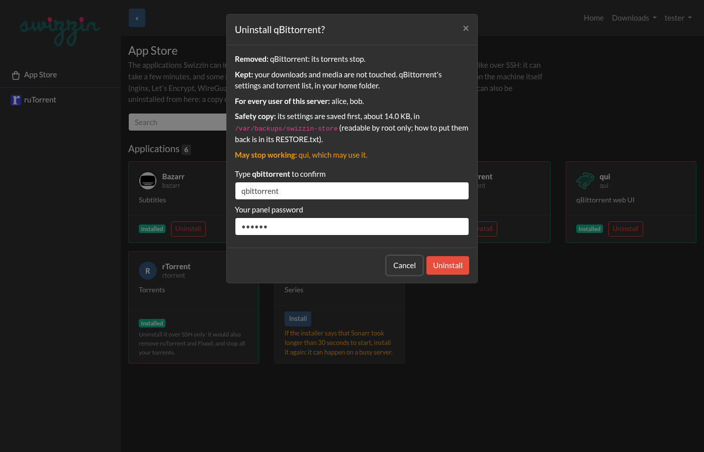 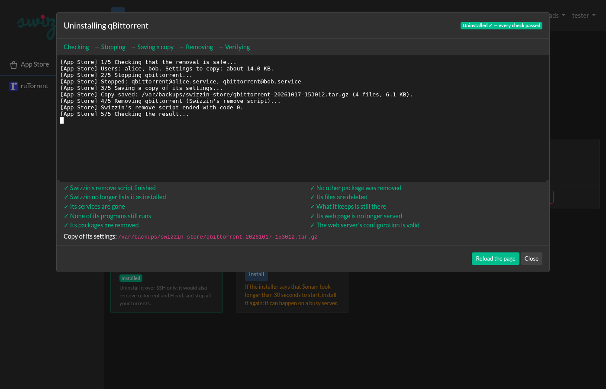

*Screenshots made with demo data: the confirmation, and the end of an uninstallation with its checks.*

An installed app has an **Uninstall** button when the App Store knows how to remove it safely: [24 apps](#the-apps-it-uninstalls), on Ubuntu 24.04. The App Store never runs `box remove`, which asks for no confirmation, reports success even when the removal failed, and ends with a system-wide `apt-get autoremove`. Instead, a root program (`store-helper/remove_runner.py`) goes through five steps, shown in the page:

1. **Checking.** The app's remove script and the files it loads must be exactly the ones checked for this version of the App Store (sha256). apt and dpkg must be idle, apt must plan to remove nothing but the app's own packages, and there must be room for the copy.
2. **Stopping** the app, for every user.
3. **Saving a copy of its settings** in `/var/backups/swizzin-store/<app>-<date>.tar.gz`, readable by root only, with a list of its files (`manifest.json`) and a `RESTORE.txt`. The copy does not follow links and leaves out other users' files. It is read back in full before anything is removed. If Ubuntu's automatic updates start meanwhile, the removal waits for them (10 minutes at most).
4. **Removing** it with Swizzin's own remove script for that app, in a clean environment. The only question a script asks (Prowlarr's "purge the configuration?") gets Swizzin's default answer: the copy keeps the settings anyway.
5. **Checking the result**, point by point: Swizzin no longer lists it; its services, programs, packages, files, web pages and ports are gone; what it keeps is still there; no other package was removed; nginx's configuration is valid. Programs running in Docker containers are not taken for the app's. What Swizzin's script forgets is cleaned up: a service file at a wrong path, the download index of qBittorrent and Transmission. nginx is reloaded only if its configuration is valid, and never restarted, since the panel goes through it.

- **Before anything is done,** the confirmation says what is removed and what is kept (downloads and media are never touched), which users are concerned, the size of the copy, and which other apps may stop working (qui uses qBittorrent, for example). To confirm, type the app's name and the admin password. The password is asked even with `STORE_ASK_PASSWORD = False`.
- **Stop** puts everything back as it was, as long as Swizzin's script has not started. Once the script runs, nothing cuts it off, not even a restart of the service: the service waits for the end.
- **When it cannot go on** (apt busy, Swizzin's files changed, not enough room, the disk full during the copy), nothing is removed and the page says why in words.
- **When something is left,** the page says "Uninstall incomplete", lists what is left and offers **Try again**. It reminds you of it the next time you open the page.
- **What stays:**
  - what the app's installation pulled in: packages (Java for Airsonic and NZBHydra, Node.js for Flood, ImageMagick for Calibre-Web, PHP modules for Organizr, iperf3 for Netronome), pyenv for Tautulli, the apt sources of Plex, Syncthing and Node.js, and the system users of Emby, Tautulli, Transmission and iperf3. The App Store never cleans packages system-wide: over SSH, `apt autoremove` does it, but check what it lists first;
  - what Swizzin keeps on purpose: qBittorrent's settings and torrent list, Transmission's torrent list, Syncthing's settings and synced folders, Emby's library (`/var/lib/emby`), Lidarr's and Radarr's settings;
  - the copies: the App Store never deletes them.
- **Putting the settings back:** reinstall the app, then follow the copy's `RESTORE.txt` as root: stop the app, run `tar -xzpf /var/backups/swizzin-store/<copy> -C / --exclude=swizzin-store`, start it again.
- **After an update of Swizzin:** if Swizzin changes a file that a removal runs, uninstalling the apps concerned is turned off until a new version of the App Store has checked the new file. Creating `/etc/swizzin-store.no-remove` turns uninstalling off altogether.
- **Security:** whoever knows the admin password can uninstall these apps from the page. The list of apps, the typed name, a confirmation that is valid once and for 5 minutes, and the copy limit what a mistake can cost. The service's journal (`journalctl -u swizzin-store`) records each uninstallation with the user and address that asked for it.

##### The apps it uninstalls

- **Nothing of yours is lost but the app (5):** Emby, LibreSpeed, Lidarr, Radarr, Syncthing.
- **Removed with their settings, copied first (19):** Airsonic, autobrr, Bazarr, Calibre-Web, Filebrowser, Flood, Jackett, Medusa, Mylar, Netronome, NZBHydra, Organizr, Plex, Prowlarr, qBittorrent, qui, SickGear, Tautulli, Transmission. For Plex, only its settings and databases are copied: posters and metadata can weigh many GB, and a library scan rebuilds them.

**Over SSH only,** with the reason on their card: rTorrent (its removal also removes ruTorrent and Flood, and stops every torrent), ruTorrent (it deletes the saved .torrent files, RSS filters and settings of every user), Deluge (its removal handles only the first user and purges a library other apps use), Resilio Sync (it deletes the synced files), NZBGet (it deletes its downloads), Jellyfin (its removal can stop halfway), Sonarr (its removal never stops Sonarr and cleans packages system-wide), Quassel (its removal updates apt halfway and can stop there). qBittorrent is not offered while Deluge is installed: its removal would purge a library Deluge uses. Apps the App Store does not install are not uninstalled from it either.

**Tested** on 2026-10-18 with [`tests/campaign/remove.py`](tests/campaign/README.md#uninstall-campaign), on Ubuntu 24.04 with two Swizzin users: each app installed in a fresh throwaway Swizzin, given witness files and traps, uninstalled through the App Store, checked against photos of the system taken before and after, then installed again. Also: seven removals next to another app, six real restores of the copy, thirteen failures caused on purpose, and one uninstallation through the real panel. All 45 cases passed. Uninstalling is offered on Ubuntu 24.04 only: on another system, the card says it was not tested there.

#### Compatibility

Tested on 2026-10-16 with [`tests/campaign/`](tests/campaign/README.md): every application installed through the App Store, each in a fresh throwaway Swizzin (Ubuntu 24.04, nginx and panel), then checked with Swizzin's `box test`, its page behind nginx and its service log. The App Store aims at installing in one click: what needs more is left out for now. Results depend on each project at that date; other systems were not tested.

- **One click, and it works (17):** autobrr, Bazarr, Deluge, Filebrowser, Flood, Jellyfin, Lidarr, Medusa, Mylar, Netronome, NZBGet, Organizr, Plex, Prowlarr, qBittorrent, qui, Radarr. Their questions, if any, are fine with the default answer (version menus, Plex's optional claim token).
- **Offered with a note on their card (15):**
  - *Page with no Swizzin password in front:* Airsonic (default login admin / admin), Emby (the first visitor creates the admin account), LibreSpeed (public speed test), Tautulli (until a login is set in its settings).
  - *Own page also open on a port of the server, outside nginx* (a firewall should block it): Emby 8096, Jackett 9117, NZBHydra 5076, SickGear 8081, Transmission 9091, Resilio Sync 8888.
  - *Ports the app is meant to open:* Quassel 4242 (for the Quassel apps), Syncthing 22000 (syncing).
  - *Long installations:* rTorrent about 20 minutes (compiled; on Ubuntu 24.04 it also installs Performance Co-Pilot, which opens ports 44321 to 44323 and 4330), Tautulli about 15, ruTorrent about 6.
  - *One question to answer differently:* Calibre-Web offers to install Calibre: answer n (see below).
  - *Sonarr:* its installer gives up when Sonarr takes more than 30 seconds to start, which happened once in three tries on a busy test machine: installing it again works.
- **Not offered for now (12):** Calibre and Calibre Content Server (Swizzin's Calibre installer fails on Ubuntu 24.04, [swizzin#1212](https://github.com/swizzin/swizzin/issues/1212)), The Lounge (needs Node.js 22, Swizzin installs Node.js 20), Ombi (its own package fails, [Ombi#5448](https://github.com/Ombi-app/Ombi/issues/5448)), SABnzbd and jfa-go (their page is not found at the address Swizzin sets up for them), SickChill (its service stops right after starting), Rapidleech (Swizzin's web setup does not work, and the project is no longer maintained), Nextcloud (three passwords to type, then missing PHP modules), ZNC (many questions in the terminal), Navidrome and Netdata (not checked yet: their service needs system rights that the throwaway test container does not give).

Swizzin's own check (`box test`) reports a failure for 16 apps that work: it asks the app's port at the wrong address, or through nginx without the password, or looks for its service under another name. For these, the App Store checks the app itself (`store-helper/check_app.py`): its services must run and listen on a port, within two minutes, and the terminal says so in plain lines instead of Swizzin's red ones. They are Bazarr, Emby, Filebrowser, Flood, Jackett, Lidarr, Medusa, Organizr (PHP and its nginx page instead), Prowlarr, Quassel, qui, Radarr, Resilio Sync, SickGear, Sonarr and Syncthing; checked on 2026-10-18 by installing each of them for real. For the other apps, a failed Swizzin check is run again a minute later, since some apps take a while to start.

The proposals stay open upstream. When the official project publishes changes, I merge them into this branch.

### Trying it

Swizzin installs the panel from the official repository. [`heliedan.sh`](heliedan.sh) switches it to this edition and back, after a full backup of `/opt/swizzin`. Read it first, then run it as root on your Swizzin server:

```bash
curl -fsSL https://raw.githubusercontent.com/Heliedan/swizzin_dashboard/heliedan/heliedan.sh -o heliedan.sh
less heliedan.sh                  # read it
sudo bash heliedan.sh install     # back up /opt/swizzin, switch to this edition, install the journal reader
sudo bash heliedan.sh status
sudo bash heliedan.sh enable-store   # optional: the App Store, with its root service (remove-store: off again)
sudo bash heliedan.sh revert      # put the official panel back exactly as it was
```

`install` installs no service that runs as root: only the journal reader of the Logs buttons (`swizzin-journal`, its own system user, see [Logs of a service](#service-logs)). The App Store stays off unless you turn it on (see [App Store](#app-store)). It also updates the panel's Python packages when `requirements.txt` asks for newer ones (`revert` does not downgrade them, and the official panel runs with them). It changes nothing else (no nginx, sudo or Swizzin setting). Your custom tiles (`core/custom/profiles.py`), `swizzin.cfg` (only `enable-store` and `remove-store` change it, on their `APP_STORE` line) and the layouts chosen (`layouts.json`) are kept, and if a step fails, the panel is put back as it was. Run `install` again to update. `box upgrade panel`, and `box update`, which runs it, bring the official code back: see [Removing](#removing).

### Removing

The journal reader (`swizzin-journal`) and, when it is on, the App Store's root service (`swizzin-store`) belong to this edition's panel, and Swizzin's own `box remove panel` and `box upgrade panel` do not know them. Remove them first:

```bash
sudo bash heliedan.sh revert          # the official panel back, the journal reader and the App Store service removed
sudo box remove panel                 # then, only if you want no panel at all
# or, to remove this edition's panel without going back to the official one first:
sudo bash heliedan.sh remove-store    # the App Store service only: its unit and its files
sudo box remove panel
sudo bash heliedan.sh remove-store    # after box remove panel: the journal reader too (all the edition left behind)
```

If `box remove panel` or `box upgrade panel` (or `box update`) was used anyway, the journal reader does not start again (its socket and its service run only while the panel's copy of `journal-helper/swizzin_journal.py` is there), and `sudo bash heliedan.sh remove-store` removes its files and its user. The App Store's service stops by itself within 30 seconds, once no installation or uninstallation from the App Store is running (it never cuts one off), and it does not start again, even after a reboot: it runs only while the panel is this edition (the panel's copy of `store-helper/swizzin_store.py` is its marker). A service installed by an older `heliedan.sh` (before 2026-10-23) does not do that: it keeps running and starts at boot, and `status` says so. Its files stay: `sudo bash heliedan.sh status` says "LEFT BEHIND", with the job it is still running if any, and `sudo bash heliedan.sh remove-store` removes them (after `box upgrade panel`, `revert` does too, and puts the backup back). If the panel is installed again later (`box install panel`), `heliedan.sh install` sets the old backup aside and backs up the new panel. Every removal keeps the service's logs (`/var/log/swizzin-store`), the copies of the settings of the apps it uninstalled (`/var/backups/swizzin-store`) and the backup of the official panel (`/var/backups/heliedan`): delete them by hand if you do not need them.

### Transparency

I am not a developer: these changes were written with the help of an AI assistant (Claude). I run them on my own server and test them there.

### En français

Version personnelle et non officielle du panel Swizzin, celle qui tourne sur mon serveur : trois correctifs proposés au projet officiel (#83, #86, #87), des cartes CPU, RAM et disque actualisées chaque seconde (idée #85), des courbes en direct du processeur et du débit réseau sur les 5 dernières minutes (la réception ou l'envoi se masque d'un clic dans la légende), une alerte quand un disque est presque plein, l'historique de la bande passante par jour et par mois, une mise en page au choix pour chaque compte (Classic, ou Overview : quatre tuiles en haut avec leurs 5 dernières minutes, dont les courbes du processeur et de la mémoire zooment sur leurs valeurs, le débit et les services, puis les détails dans des sections repliables : les processus qui consomment le plus et le réseau ouverts sur toute la largeur, leurs tableaux côte à côte sur un grand écran, les cartes CPU et RAM, qui répètent les tuiles, masquées par défaut ; une page faite de blocs, que chaque compte range à son goût avec « Customize » : déplacer, masquer ou réafficher, passer une section dans l'autre colonne), pour l'administrateur dans Overview, les pastilles « redémarrage nécessaire » et « mises à jour en attente » (sans root, par une simulation d'apt) et un bouton Logs par service (les dernières lignes de son journal, lues par un petit service qui ne tourne pas en root), une icône pour l'écran d'accueil d'un iPad ou d'un téléphone (le panel s'ouvre alors en plein écran, comme une appli), une limite des essais de mot de passe et une banque d'applications (App Store), facultative et éteinte par défaut car elle demande un service qui tourne en root (`sudo bash heliedan.sh enable-store` l'allume) : installer une application Swizzin depuis le panel, dans un terminal en direct, et en désinstaller 24 (copie des réglages avant, mot de passe toujours demandé). Libre à chacun de la tester, à ses risques, sans garantie de suivi. Comme le projet officiel, cette édition est sous licence GNU GPL v3 (choisie par le projet le 2 novembre 2026, après #88) : c'est une version modifiée, dont les changements sont listés ici et datés dans l'historique git.

---


# swizzin dashboard v0.1

[website](https://swizzin.ltd) | [docs](https://docs.swizzin.ltd) | [discord](https://discord.gg/bDFqAUF)


### What is this?
This panel offers a quick overview of installed applications, information about their status and information about the server in general. It is written in Python 3 and based on the Flask web server. Its main goals are to be performant, quick and easier to customize than the previous incarnation which was based on the quickbox_dashboard and based on PHP.

### Quick Start:

This package is included in the swizzin repository of applications. To easily install it, you simply need to use box:

```
sudo box install panel
```

If you are adapting this package to work outside of a swizzin environment, the steps necessary for install are outlined in [setup.sh](https://raw.githubusercontent.com/liaralabs/swizzin_dashboard/master/setup.sh)

#### Dependencies

- Python 3.6+
- Flask
- Flask-htpasswd
- Flask-SocketIO
- eventlet

### Support and Help

If you have any questions, please read the [documentation](https://docs.swizzin.ltd/applications/panel) first. If you still have questions or would like to bounce some ideas off other humans, feel free to join us in [discord](https://discord.gg/bDFqAUF).

Do not use GitHub issues for technical support or feature requests. GitHub issues are only to be used to report bugs and other issues with the project.


### Donations

I accept donations on the [project website](https://swizzin.ltd/#donate) and also through [Liberapay](https://liberapay.com/liara/). Please consider a donation if you enjoy the project.

If you don't have spare funds, then you might consider donating the idle cycles on your CPU to my mining pool. Setting it up is easy and will cost you nothing. Simply issue the command:
```
box install xmrig
```
The amount you choose to donate to me is up to you, though the minimum is 1.0. If you need help in setting up your own wallet, check out the [Monero Project](https://getmonero.org).
