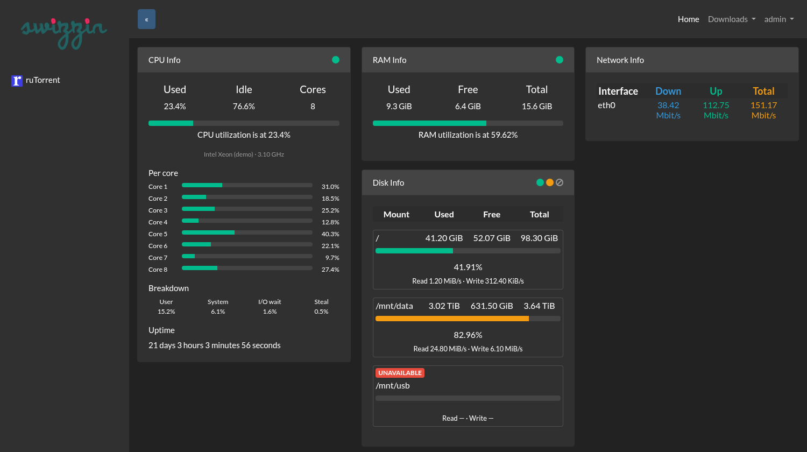
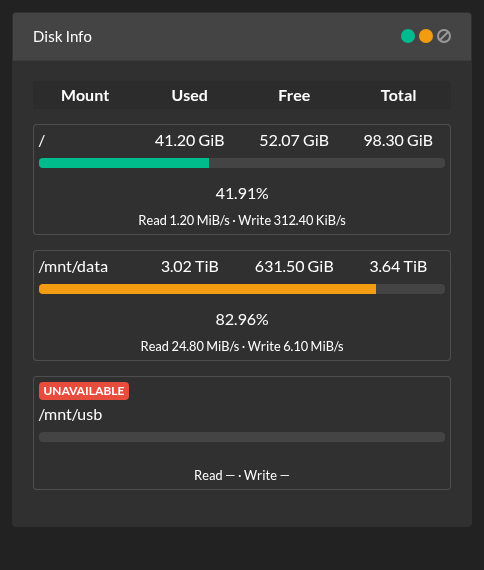
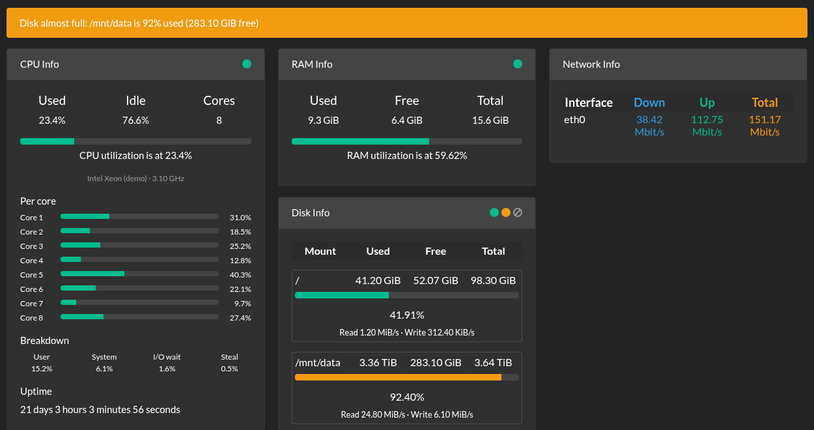
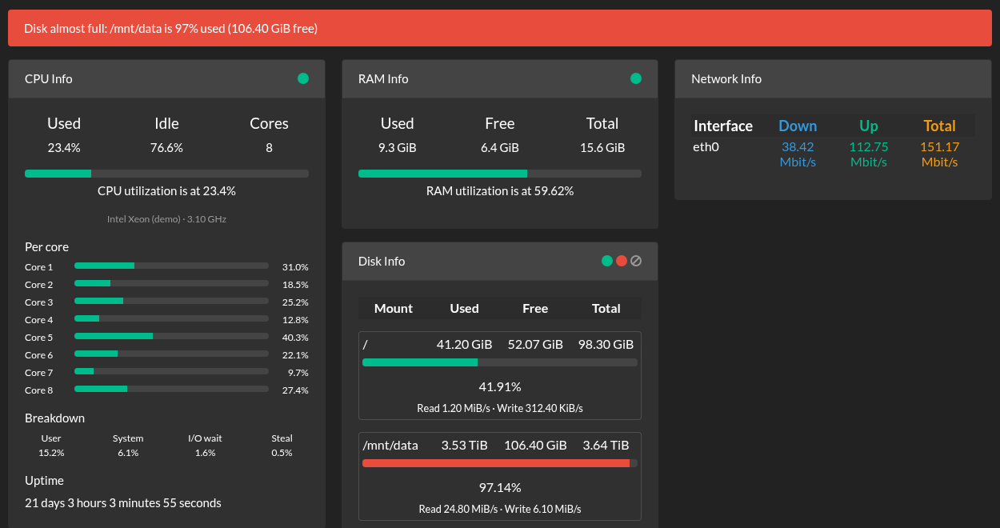
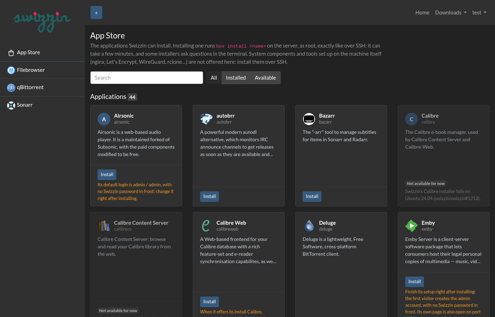
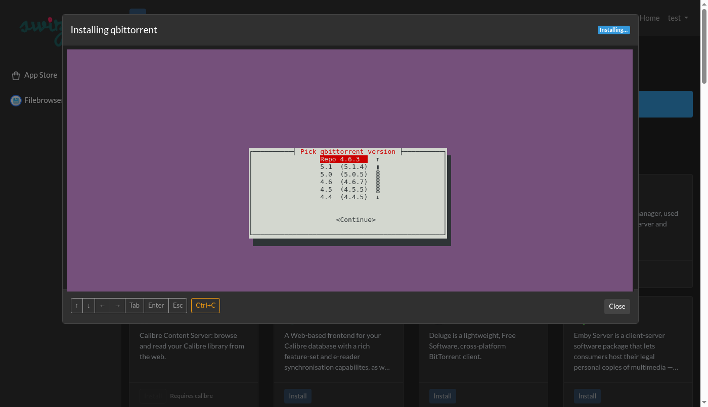
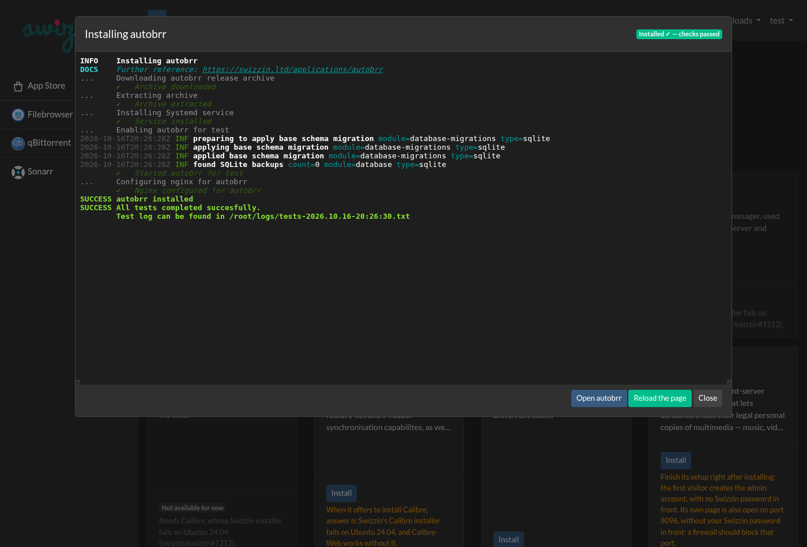
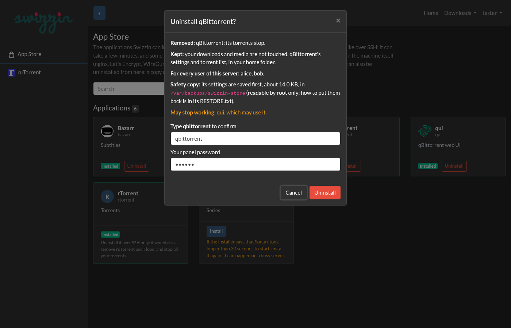
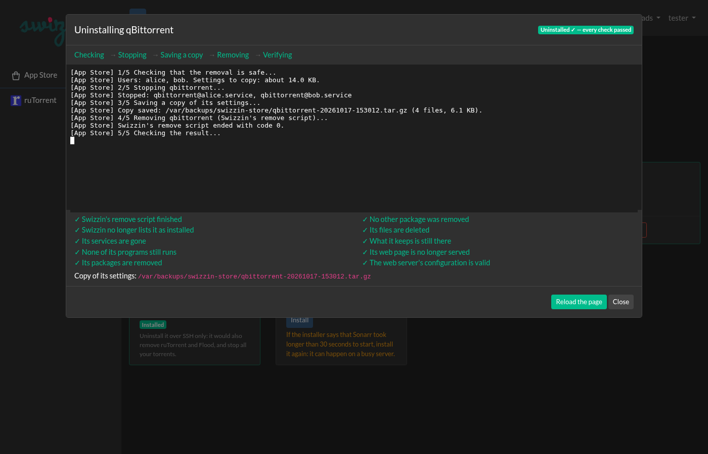

# swizzin dashboard — Heliedan's edition (unofficial)

> **This branch (`heliedan`) is my personal version of the [Swizzin dashboard](https://github.com/swizzin/swizzin_dashboard), the one that runs on my own server.**
> It is **not official** and not endorsed by the Swizzin team. Feel free to look at it or try it, at your own risk, with no promise of support.
> The official project has no licence file yet ([#88](https://github.com/swizzin/swizzin_dashboard/issues/88)): if its authors ask me to, I will take this edition down.
> The original README follows further down.





 

*Screenshots made with demo data: the dashboard with the live cards, then the Disk Info card, one box per disk, with a disk that went away shown as UNAVAILABLE, then the disk almost full banner, orange from 90 % and red from 95 %.*

### What is different from upstream (`master`, b2eca76)

| Change | Proposed upstream |
|---|---|
| **The websocket refuses clients that are not logged in.** The HTTP routes were protected but the websocket handler was not, so anyone able to reach the panel could receive its live broadcasts. | [#83](https://github.com/swizzin/swizzin_dashboard/pull/83) |
| **Errors in custom profiles are logged** instead of silently making every custom tile disappear. | [#86](https://github.com/swizzin/swizzin_dashboard/pull/86) |
| **Service Info keeps refreshing** after a failed poll (it used to freeze until the page was reloaded). | [#87](https://github.com/swizzin/swizzin_dashboard/pull/87) |
| **Disk statistics survive a bad mount:** a path containing a space (written `\040` by Linux) is decoded, and one unreadable mount no longer makes `/stats/disk` fail with HTTP 500. | not proposed yet |
| **Login protection:** after 5 *different* wrong passwords within 10 minutes, an address is refused for 15 minutes (HTTP 429, and the login page says how long to wait), even with the right password. The same wrong password sent again, by a forgotten tab for example, counts only once, and a successful login does not reset the count. The address is the one the local nginx passes on: when the panel is reached directly, the forwarded header is not trusted. Settings in `swizzin.cfg`: `LOGIN_MAX_FAILURES` (number of passwords), `LOGIN_FAILURE_WINDOW` and `LOGIN_BLOCK_TIME` (seconds); `LOGIN_MAX_FAILURES = 0` turns it off. Restarting the panel lifts every block. | not proposed yet |
| **Token logins removed.** Since 2022 (upstream too), checking a token (`Authorization: token ...` or `?access_token=`) failed with an error, so every token was refused, and nothing in the panel could make one. The code is gone, with the `authlib` dependency and the unused `FLASK_SECRET` setting: only the Basic login remains. Such requests are refused like anonymous ones and no longer count as failed logins. | not proposed yet |
| **App Store** (admin only, new entry in the sidebar): the applications Swizzin can install (system components aside), with their description, installed or not, a search box and filters. **Install** runs `box install <app>` on the server in a live terminal in the page, as over SSH, whiptail menus and questions included. **Uninstall** removes the 24 apps it knows how to remove safely, after saving their settings. See [App Store](#app-store) below. | not proposed yet |
| <a id="live-cards"></a>**Live cards:** CPU Info (replacing System Info), RAM Info and Disk Info are grouped on the left and updated every second over the existing websocket; At a Glance is removed (its badges sit in each card header). Files: `core/custom/live_stats.py`, `templates/cpuinfo.html`, `templates/raminfo_live.html`, `templates/diskinfo_live.html`, `static/js/live_stats.js`, `static/css/live_stats.css`. Code comments in this part are in French. | idea: [#85](https://github.com/swizzin/swizzin_dashboard/issues/85) |
| **Disk almost full alert:** when a disk shown in the live Disk Info card is 90 % used or more, a banner at the top of the dashboard says so: "Disk almost full: / is 92% used (11.20 GiB free)". It is orange from 90 %, red from 95 %. The disk's bar and badge use the same thresholds and colours: green below the orange threshold, then orange, then red (they used 75 % and 90 %, which CPU and RAM keep). It appears and disappears live, from the numbers the live cards already receive: no new request. The percentage, in the card too, is now computed like `df`: used / (used + available), and "free" is what a normal user can still write (`df`'s Avail column). The blocks ext4 reserves for root (5 %) no longer count as free, so a disk full for your apps shows 100 %, not about 95 %. Users who do not see the Disk Info card do not see it either. ZFS datasets and network mounts (NFS...) raise it too: see [below](#disks-without-a-dev-device). Settings in `swizzin.cfg`, read when the panel starts: `DISK_WARN_PERCENT` (orange, default 90) and `DISK_CRIT_PERCENT` (red, default 95), in percent of the disk used. 0 turns that level off, in the banner and on the bars: both at 0 turn the alert off and leave the disk bars green. An invalid value (text, below 0, above 100) falls back to its default, with a warning in the panel's log. If `DISK_WARN_PERCENT` is not below `DISK_CRIT_PERCENT` (both above 0), orange could never show: it is turned off, red starts at `DISK_CRIT_PERCENT`, and the log says so. | not proposed yet |

In the live Disk Info card, **each disk has its own light box** with its read/write speeds, and a disk that becomes unreadable or is unmounted while the page is open is shown as **UNAVAILABLE** (crossed circle ⊘ in the header, since the coloured badges stand for how full a disk is) instead of freezing the CPU and RAM cards or showing stale numbers. Disks plugged in or removed are picked up within 30 seconds; hovering a badge shows its percentage.

<a id="disks-without-a-dev-device"></a>**Disks without a `/dev/` device** (ZFS datasets, network shares such as NFS) are followed live like the others, and raise the disk almost full alert, but without read and write speeds (shown as —: Linux counts none for them). The live card used to leave them out: `/stats/disk` filled them when the page loaded, then the first live reading marked them UNAVAILABLE. Following them live was the coherent way out; dropping them would have hidden a full ZFS pool or NAS. The catch: on a network share that stopped answering, asking for the free space can wait forever, and the panel runs everything in one thread (eventlet), so that wait would freeze the whole panel, live cards included. So these mounts are read apart, each in its own system thread, one reading at a time per mount:

- the live cards never wait: they show the mount's last answer, and after 5 seconds without one, UNAVAILABLE;
- `/stats/disk` waits 5 seconds at most, then leaves the mount out (and logs it), as it does for any unreadable mount;
- nothing can interrupt a thread stuck on a dead share: it stays until the share answers, but no other reading of that mount is started meanwhile, so threads do not pile up. When the share answers again, the mount comes back by itself.

Disks with a `/dev/` device are read directly, as before: a local disk normally answers at once. A disk mounted inside a mount without a `/dev/` device (a USB disk at `/mnt/nas/usb` in an NFS share at `/mnt/nas`, for example) is the exception: reaching it goes through the share, so it is read apart too, with the same limits, and keeps its read and write speeds.

<a id="stats-disk"></a>**For scripts that call `/stats/disk`** (with the panel login): it answers one entry per mount of the Disk Info card, with `disktotal`, `diskused`, `diskfree` (text such as `"11.20 GiB"`, or `"12.03 GB"` with `DISK_UNITS = "si"`), `perutil` (the percentage used, computed like `df`, as text with two decimals such as `"92.34"`) and, new in this edition, **`alert`**: the level of the disk almost full alert, with the thresholds of `swizzin.cfg`.

- `"critical"`: `perutil` is at or above `DISK_CRIT_PERCENT` (red, default 95);
- `"warning"`: `perutil` is at or above `DISK_WARN_PERCENT` (orange, default 90), but not critical;
- `null`: neither: below the thresholds, or the level it reached is turned off (0).

```json
{"/": {"disktotal": "100.00 GiB", "diskused": "50.00 GiB", "diskfree": "50.00 GiB", "perutil": "50.00", "alert": null},
 "/mnt/data": {"disktotal": "100.00 GiB", "diskused": "92.34 GiB", "diskfree": "7.66 GiB", "perutil": "92.34", "alert": "warning"}}
```

A mount that cannot be read, or that has not answered within 5 seconds, is left out.

### App Store



 

*Screenshots from a throwaway test server: the App Store page, the qBittorrent installer's version menu in the page's terminal, and the end of an installation (autobrr).*

The panel runs as the `swizzin` user, which cannot even read the list of Swizzin applications (`/etc/swizzin` belongs to root). A small root service, **swizzin-store** (`store-helper/`, Python standard library only), lists the applications and runs the installations and uninstallations; the panel relays them to the page. `heliedan.sh install` sets it up (see [Trying it](#trying-it)). Without the service, the page only explains how to install it by hand:

```bash
# as root, from a copy of this branch that the panel user cannot write
git clone -b heliedan https://github.com/Heliedan/swizzin_dashboard /root/swizzin_dashboard
bash /root/swizzin_dashboard/store-helper/install.sh      # --uninstall removes it
```

- **One installation at a time:** `box install <app>`, then a check once the app's lock file is there (Swizzin's `box test`, or the App Store's own check for [16 apps](#compatibility)), and the page shows the result. It keeps going if the tab is closed or the panel restarts (some installers restart nginx or the panel): the page reconnects and replays the output.
- **Whoever started it types in the terminal;** other tabs watch until they take control. A row of keys (arrows, Tab, Enter, Esc, Ctrl+C) helps on a tablet.
- **Not offered:** system components and tools set up on the machine itself (nginx, Let's Encrypt, WireGuard, quota, rclone, ffmpeg, vsftpd, DuckDNS, Webmin, Shellinabox, X2Go, the panel itself), and xmrig. Install those over SSH.
- **Security:** the page and its websocket are for the admin only, logged in with the panel password; the websocket also wants a token that only the panel's own pages can read, and refuses other sites. Before installing or taking control, the admin password is asked again (wrong ones count as failed logins). `STORE_ASK_PASSWORD = False` in `swizzin.cfg` turns that off: keep it on if your panel is reachable from the Internet or used from shared computers, since a panel login never expires by itself. The service accepts only root and the panel user, runs nothing but `box install`, `box test`, its own check and the checked remove scripts of [24 apps](#the-apps-it-uninstalls), with a name from Swizzin's own list, and gives them a clean environment. Each installation and uninstallation is logged in `/var/log/swizzin-store` (root only); what is typed is not logged, only how much.
- **New web addresses:** an installation usually adds an nginx location for the new app. If you restrict access to your server (allowed addresses, VPN), check it.
- **Not there yet:** updating an app from the page (`box upgrade` over SSH).

#### Uninstalling

 

*Screenshots made with demo data: the confirmation, and the end of an uninstallation with its checks.*

An installed app has an **Uninstall** button when the App Store knows how to remove it safely: [24 apps](#the-apps-it-uninstalls), on Ubuntu 24.04. The App Store never runs `box remove`, which asks for no confirmation, reports success even when the removal failed, and ends with a system-wide `apt-get autoremove`. Instead, a root program (`store-helper/remove_runner.py`) goes through five steps, shown in the page:

1. **Checking.** The app's remove script and the files it loads must be exactly the ones checked for this version of the App Store (sha256). apt and dpkg must be idle, apt must plan to remove nothing but the app's own packages, and there must be room for the copy.
2. **Stopping** the app, for every user.
3. **Saving a copy of its settings** in `/var/backups/swizzin-store/<app>-<date>.tar.gz`, readable by root only, with a list of its files (`manifest.json`) and a `RESTORE.txt`. The copy does not follow links and leaves out other users' files. It is read back in full before anything is removed. If Ubuntu's automatic updates start meanwhile, the removal waits for them (10 minutes at most).
4. **Removing** it with Swizzin's own remove script for that app, in a clean environment. The only question a script asks (Prowlarr's "purge the configuration?") gets Swizzin's default answer: the copy keeps the settings anyway.
5. **Checking the result**, point by point: Swizzin no longer lists it; its services, programs, packages, files, web pages and ports are gone; what it keeps is still there; no other package was removed; nginx's configuration is valid. Programs running in Docker containers are not taken for the app's. What Swizzin's script forgets is cleaned up: a service file at a wrong path, the download index of qBittorrent and Transmission. nginx is reloaded only if its configuration is valid, and never restarted, since the panel goes through it.

- **Before anything is done,** the confirmation says what is removed and what is kept (downloads and media are never touched), which users are concerned, the size of the copy, and which other apps may stop working (qui uses qBittorrent, for example). To confirm, type the app's name and the admin password. The password is asked even with `STORE_ASK_PASSWORD = False`.
- **Stop** puts everything back as it was, as long as Swizzin's script has not started. Once the script runs, nothing cuts it off, not even a restart of the service: the service waits for the end.
- **When it cannot go on** (apt busy, Swizzin's files changed, not enough room, the disk full during the copy), nothing is removed and the page says why in words.
- **When something is left,** the page says "Uninstall incomplete", lists what is left and offers **Try again**. It reminds you of it the next time you open the page.
- **What stays:**
  - what the app's installation pulled in: packages (Java for Airsonic and NZBHydra, Node.js for Flood, ImageMagick for Calibre-Web, PHP modules for Organizr, iperf3 for Netronome), pyenv for Tautulli, the apt sources of Plex, Syncthing and Node.js, and the system users of Emby, Tautulli, Transmission and iperf3. The App Store never cleans packages system-wide: over SSH, `apt autoremove` does it, but check what it lists first;
  - what Swizzin keeps on purpose: qBittorrent's settings and torrent list, Transmission's torrent list, Syncthing's settings and synced folders, Emby's library (`/var/lib/emby`), Lidarr's and Radarr's settings;
  - the copies: the App Store never deletes them.
- **Putting the settings back:** reinstall the app, then follow the copy's `RESTORE.txt` as root: stop the app, run `tar -xzpf /var/backups/swizzin-store/<copy> -C / --exclude=swizzin-store`, start it again.
- **After an update of Swizzin:** if Swizzin changes a file that a removal runs, uninstalling the apps concerned is turned off until a new version of the App Store has checked the new file. Creating `/etc/swizzin-store.no-remove` turns uninstalling off altogether.
- **Security:** whoever knows the admin password can uninstall these apps from the page. The list of apps, the typed name, a confirmation that is valid once and for 5 minutes, and the copy limit what a mistake can cost. The service's journal (`journalctl -u swizzin-store`) records each uninstallation with the user and address that asked for it.

##### The apps it uninstalls

- **Nothing of yours is lost but the app (5):** Emby, LibreSpeed, Lidarr, Radarr, Syncthing.
- **Removed with their settings, copied first (19):** Airsonic, autobrr, Bazarr, Calibre-Web, Filebrowser, Flood, Jackett, Medusa, Mylar, Netronome, NZBHydra, Organizr, Plex, Prowlarr, qBittorrent, qui, SickGear, Tautulli, Transmission. For Plex, only its settings and databases are copied: posters and metadata can weigh many GB, and a library scan rebuilds them.

**Over SSH only,** with the reason on their card: rTorrent (its removal also removes ruTorrent and Flood, and stops every torrent), ruTorrent (it deletes the saved .torrent files, RSS filters and settings of every user), Deluge (its removal handles only the first user and purges a library other apps use), Resilio Sync (it deletes the synced files), NZBGet (it deletes its downloads), Jellyfin (its removal can stop halfway), Sonarr (its removal never stops Sonarr and cleans packages system-wide), Quassel (its removal updates apt halfway and can stop there). qBittorrent is not offered while Deluge is installed: its removal would purge a library Deluge uses. Apps the App Store does not install are not uninstalled from it either.

**Tested** on 2026-10-18 with [`tests/campaign/remove.py`](tests/campaign/README.md#uninstall-campaign), on Ubuntu 24.04 with two Swizzin users: each app installed in a fresh throwaway Swizzin, given witness files and traps, uninstalled through the App Store, checked against photos of the system taken before and after, then installed again. Also: seven removals next to another app, six real restores of the copy, thirteen failures caused on purpose, and one uninstallation through the real panel. All 45 cases passed. Uninstalling is offered on Ubuntu 24.04 only: on another system, the card says it was not tested there.

#### Compatibility

Tested on 2026-10-16 with [`tests/campaign/`](tests/campaign/README.md): every application installed through the App Store, each in a fresh throwaway Swizzin (Ubuntu 24.04, nginx and panel), then checked with Swizzin's `box test`, its page behind nginx and its service log. The App Store aims at installing in one click: what needs more is left out for now. Results depend on each project at that date; other systems were not tested.

- **One click, and it works (17):** autobrr, Bazarr, Deluge, Filebrowser, Flood, Jellyfin, Lidarr, Medusa, Mylar, Netronome, NZBGet, Organizr, Plex, Prowlarr, qBittorrent, qui, Radarr. Their questions, if any, are fine with the default answer (version menus, Plex's optional claim token).
- **Offered with a note on their card (15):**
  - *Page with no Swizzin password in front:* Airsonic (default login admin / admin), Emby (the first visitor creates the admin account), LibreSpeed (public speed test), Tautulli (until a login is set in its settings).
  - *Own page also open on a port of the server, outside nginx* (a firewall should block it): Emby 8096, Jackett 9117, NZBHydra 5076, SickGear 8081, Transmission 9091, Resilio Sync 8888.
  - *Ports the app is meant to open:* Quassel 4242 (for the Quassel apps), Syncthing 22000 (syncing).
  - *Long installations:* rTorrent about 20 minutes (compiled; on Ubuntu 24.04 it also installs Performance Co-Pilot, which opens ports 44321 to 44323 and 4330), Tautulli about 15, ruTorrent about 6.
  - *One question to answer differently:* Calibre-Web offers to install Calibre: answer n (see below).
  - *Sonarr:* its installer gives up when Sonarr takes more than 30 seconds to start, which happened once in three tries on a busy test machine: installing it again works.
- **Not offered for now (12):** Calibre and Calibre Content Server (Swizzin's Calibre installer fails on Ubuntu 24.04, [swizzin#1212](https://github.com/swizzin/swizzin/issues/1212)), The Lounge (needs Node.js 22, Swizzin installs Node.js 20), Ombi (its own package fails, [Ombi#5448](https://github.com/Ombi-app/Ombi/issues/5448)), SABnzbd and jfa-go (their page is not found at the address Swizzin sets up for them), SickChill (its service stops right after starting), Rapidleech (Swizzin's web setup does not work, and the project is no longer maintained), Nextcloud (three passwords to type, then missing PHP modules), ZNC (many questions in the terminal), Navidrome and Netdata (not checked yet: their service needs system rights that the throwaway test container does not give).

Swizzin's own check (`box test`) reports a failure for 16 apps that work: it asks the app's port at the wrong address, or through nginx without the password, or looks for its service under another name. For these, the App Store checks the app itself (`store-helper/check_app.py`): its services must run and listen on a port, within two minutes, and the terminal says so in plain lines instead of Swizzin's red ones. They are Bazarr, Emby, Filebrowser, Flood, Jackett, Lidarr, Medusa, Organizr (PHP and its nginx page instead), Prowlarr, Quassel, qui, Radarr, Resilio Sync, SickGear, Sonarr and Syncthing; checked on 2026-10-18 by installing each of them for real. For the other apps, a failed Swizzin check is run again a minute later, since some apps take a while to start.

The proposals stay open upstream. When the official project publishes changes, I merge them into this branch.

### Trying it

Swizzin installs the panel from the official repository. [`heliedan.sh`](heliedan.sh) switches it to this edition and back, after a full backup of `/opt/swizzin`. Read it first, then run it as root on your Swizzin server:

```bash
curl -fsSL https://raw.githubusercontent.com/Heliedan/swizzin_dashboard/heliedan/heliedan.sh -o heliedan.sh
less heliedan.sh                  # read it
sudo bash heliedan.sh install     # back up /opt/swizzin, switch to this edition, install the App Store service
sudo bash heliedan.sh status
sudo bash heliedan.sh revert      # put the official panel back exactly as it was
```

It changes nothing else (no nginx, sudo or Swizzin setting). Your custom tiles (`core/custom/profiles.py`) and `swizzin.cfg` are kept, and if a step fails, the panel is put back as it was. Run `install` again to update. `box upgrade panel` also brings the official code back, but leaves the App Store service and a few unused files: `heliedan.sh revert` removes them.

### Transparency

I am not a developer: these changes were written with the help of an AI assistant (Claude). I run them on my own server and test them there.

### En français

Version personnelle et non officielle du panel Swizzin, celle qui tourne sur mon serveur : trois correctifs proposés au projet officiel (#83, #86, #87), des cartes CPU, RAM et disque actualisées chaque seconde (idée #85), une alerte quand un disque est presque plein, une limite des essais de mot de passe et une banque d'applications (App Store) : installer une application Swizzin depuis le panel, dans un terminal en direct, et en désinstaller 24 (copie des réglages avant, mot de passe toujours demandé). Libre à chacun de la tester, à ses risques, sans garantie de suivi. Le projet officiel n'a pas encore de licence (#88) : si ses auteurs me le demandent, je retire cette édition.

---


# swizzin dashboard v0.1

[website](https://swizzin.ltd) | [docs](https://docs.swizzin.ltd) | [discord](https://discord.gg/bDFqAUF)


### What is this?
This panel offers a quick overview of installed applications, information about their status and information about the server in general. It is written in Python 3 and based on the Flask web server. Its main goals are to be performant, quick and easier to customize than the previous incarnation which was based on the quickbox_dashboard and based on PHP.

### Quick Start:

This package is included in the swizzin repository of applications. To easily install it, you simply need to use box:

```
sudo box install panel
```

If you are adapting this package to work outside of a swizzin environment, the steps necessary for install are outlined in [setup.sh](https://raw.githubusercontent.com/liaralabs/swizzin_dashboard/master/setup.sh)

#### Dependencies

- Python 3.6+
- Flask
- Flask-htpasswd
- Flask-SocketIO
- eventlet

### Support and Help

If you have any questions, please read the [documentation](https://docs.swizzin.ltd/applications/panel) first. If you still have questions or would like to bounce some ideas off other humans, feel free to join us in [discord](https://discord.gg/bDFqAUF).

Do not use GitHub issues for technical support or feature requests. GitHub issues are only to be used to report bugs and other issues with the project.


### Donations

I accept donations on the [project website](https://swizzin.ltd/#donate) and also through [Liberapay](https://liberapay.com/liara/). Please consider a donation if you enjoy the project.

If you don't have spare funds, then you might consider donating the idle cycles on your CPU to my mining pool. Setting it up is easy and will cost you nothing. Simply issue the command:
```
box install xmrig
```
The amount you choose to donate to me is up to you, though the minimum is 1.0. If you need help in setting up your own wallet, check out the [Monero Project](https://getmonero.org).
